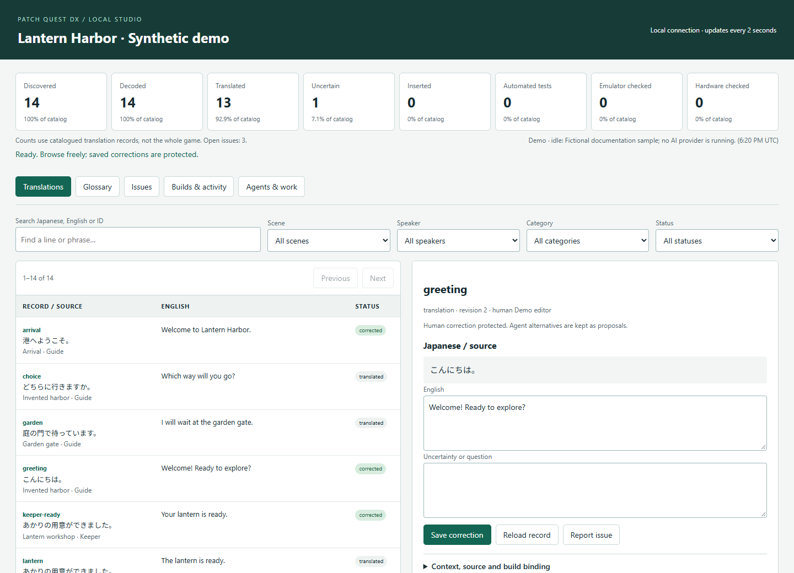
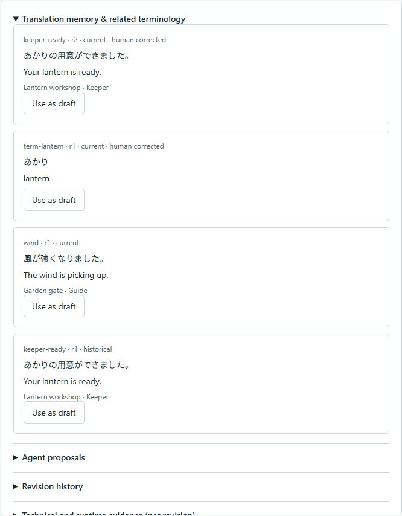
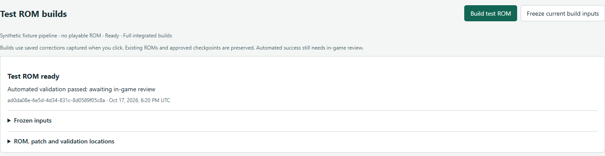
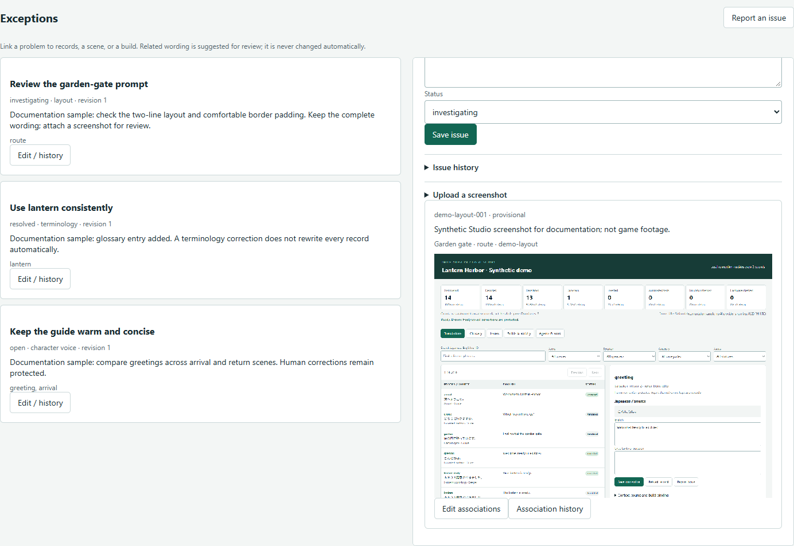
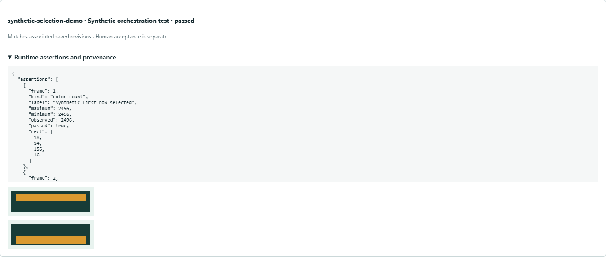
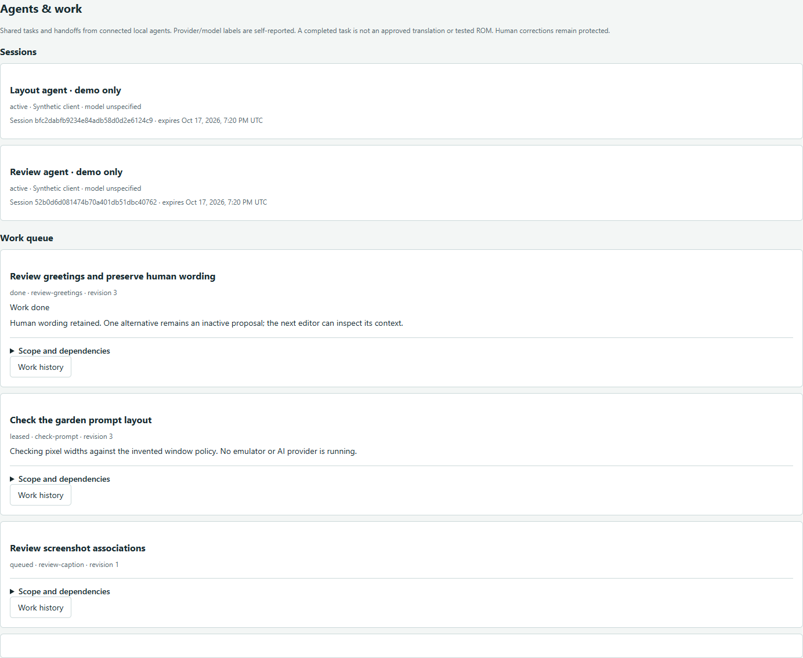

# Patch Quest DX

*AI-driven discovery. Automated localization. Human refinement.*

Patch Quest DX is an **AI-driven ROM reverse-engineering and localization
platform**. It equips coding agents to investigate games, discover where text
lives and how it is drawn, translate Japanese content, develop game-specific
tools, build patches and validate the result. The current console tooling focuses
on SNES games, with reusable state, layout and collaboration APIs around it.

**Automatic by default. Human correction by exception.**

The aim is to automate routine investigation, engineering, translation, building
and validation within an agreed project scope. People retain authority over
corrections, creative judgment, visual quality and final acceptance. Translation
Studio makes that work visible and editable; the shared instructions, tools and
project state also support agents working without the browser.

[Localization workflow](#the-localization-workflow) · [Current capabilities](#what-is-available-today) ·
[Feature tour](#feature-tour) · [Try the Studio](#try-the-studio) ·
[Developer tools](#developer-tools) · [Documentation](#documentation) ·
[Licensing](#licensing)

## The localization workflow

1. **Investigate the game.** Coding agents inspect an explicitly selected ROM,
   form and test hypotheses about encodings, text pointers, fonts, control codes
   and rendering behavior, and retain verified findings in its private project.
   Inspection tools assist this work; they do not automatically understand an
   unfamiliar game's systems.
2. **Engineer the adapter.** Agents develop extraction, insertion, rendering and
   build tools around the reusable platform APIs. Each game's storage limits,
   renderer hooks and resource allocations need their own verification.
3. **Translate in context.** Agents use the Japanese source, surrounding scenes,
   terminology and available evidence to preserve tonal identity, atmosphere,
   character voices, relationships and emotional intent. Uncertain context stays
   explicit; English wording should not be distorted to fit a box.
4. **Keep corrections authoritative.** Shared state retains translations,
   contextual memory, history and protected human corrections. Studio provides
   an accessible place to review exceptions and refine wording; agents use the
   same records through the API.
5. **Build and verify.** Freeze saved revisions, plan text layout, generate a
   derivative and patch, and validate source identity, edits, resource limits
   and patch reconstruction. Supported emulator checks require a configured
   integration and explicit scenarios; static checks alone cannot prove gameplay.
6. **Review and iterate.** Human review focuses on meaningful corrections,
   readability, navigation, timing and final acceptance. Feed findings back into
   the project while retaining earlier checkpoints and evidence.

**The coding agents perform discovery and translation.** You run clients such as
Codex or Claude Code against a selected project. Opening Studio does not invoke
an AI provider, and **Build test ROM** runs an already-configured private build
pipeline; it does not discover a game's format or translate missing text.

## What is available today?

| Status | Scope |
|---|---|
| **Public platform** | ROM inspection and guarded editing primitives, SNES utilities, BPS tools, Quest Pixel typography, intelligent dialogue-layout planning, persistent translation state, Studio, browser build jobs and agent coordination. Game-specific integration is required. |
| **Demonstrated in private integrations** | Agent-led reverse engineering, translation, renderer adaptations, reproducible game builds and targeted emulator verification. Their adapters, inputs and evidence remain private; results apply to the tested projects and scenarios. |
| **Development previews** | Structured narrative-context guides and integrated runtime inspection/reporting. These are demonstrated below but are not yet included in the published code. |
| **Longer-term direction** | More autonomous discovery and translation of unfamiliar games, with broader coverage and stronger verification. Arbitrary-ROM-to-complete-English-translation automation is not implemented. |

The public repository supplies reusable tooling, instructions and synthetic
examples. Each game's ROMs, text, research and adapters stay in a separate private
project. No game releases or extracted game data are included here.



*Actual Studio screenshots use the invented Lantern Harbor demo. No commercial
game text, ROM graphics or private project data is shown. Its build uses fictional
bytes; its runtime example uses a synthetic grid.
[Screenshot provenance](docs/images/studio/README.md).*

Screenshots were captured from the development workspace, including the labelled
previews; their appearance may differ from the published checkout.

## Try the Studio

Use **Python 3.10+ with SQLite** and a browser. Studio and the synthetic examples
need no third-party Python packages or provider accounts, and download nothing
automatically. Coding-agent clients are configured separately when you want an
agent to investigate or translate. Git is used for source development and
publication audits.

From the platform checkout:

```sh
python tools/patchquest.py doctor
python examples/studio-demo.py --workspace .local/projects/studio-demo
python tools/patchquest.py studio .local/projects/studio-demo/project.json --port 0
```

Open the private session URL printed in the terminal. Leave the terminal running;
Ctrl+C stops the server. The demo needs a fresh destination initially. Later, rerun
only the Studio command to reopen saved data. It starts with a small fictional
catalogue; the screenshots show additional invented examples.

Studio binds to loopback and requires a per-session token. It does not contact an
AI service. Keep the launch URL private and the server on your machine. The demo
has no playable ROM or build worker; real builds use your private project's
explicit validated worker launcher.

[Setup guide](docs/local-setup.md) · [Studio guide](docs/translation-studio.md) ·
[Private project starter](templates/project/README.md)

## Feature tour

### Investigate ROMs and develop game-specific tools

Start with explicit inputs and reproducible observations. The public tools
calculate hashes, inspect possible SNES headers and checksums, decode planar
graphics tiles, and provide linear 65816 disassembly. Guarded extraction preserves
unknown bytes; insertion checks expected source bytes and rejects overlapping
edits. Agents supply verified text ranges, encoding tables and build recipes
instead of relying on a universal game detector.

The [SNES translation skill](.agents/skills/snes-translation/SKILL.md) connects
inspection, private research, translation and incremental verification. Reusable
methods belong in the platform; actual game addresses, hooks and findings stay
with the private adapter. Header guesses and static disassembly are starting
points, not proof of runtime behavior.

### Edit with context and preserve human judgment

Studio is the review surface for the shared localization workflow. It is optional:
the same persistent records and build interfaces remain available to agents and
headless tools.

Search source text, English or record IDs; filter by scene, speaker, category and
status. Inspect controls, context, build bindings and revision history alongside
the wording. Saved human corrections are protected: agents can offer alternatives
as proposals, and stale writes are rejected. Restoring earlier wording creates a
new revision while retaining history.

Progress distinguishes discovery, translation, uncertainty, insertion, automated
tests, emulator checks and hardware checks. Counts describe the catalogue; they
do not claim that every text path in a game has been found or tested.

### Translation memory and terminology

Reuse relevant wording from shared history and the contextual glossary.
Suggestions distinguish current, historical and human-corrected entries.
**Use as draft** lets you compare a suggestion before saving; it does not rewrite
related records. Memory uses lexical and context scoring, with no embedding service.



### Build from saved corrections

**Build test ROM** captures an immutable snapshot and queues a full build through
an explicitly registered private pipeline. Follow stages, retained failures and
result locations in the browser. Duplicate requests and concurrent builds are
guarded; later edits belong to a later snapshot. Unsaved drafts are excluded.

The private adapter is responsible for validating encoding, controls, layout,
allocation, checksums and patch reconstruction before reporting success.
Technical success does not approve a checkpoint or certify gameplay.
**Freeze current build inputs** saves a snapshot without starting a build.



*This exercises the real job workflow with a synthetic callback. “Test ROM ready”
is the standard job label; this demo produces invented binary data and a patch,
not a playable game.*

### Report issues with screenshots

Track wording, voice, layout and gameplay concerns against records, scenes and
builds. Upload PNG/JPEG evidence, retain provisional associations, and correct
links with revision checks and history. Images stay in the private project;
automatic OCR and screenshot-to-text matching are not implemented.



### Inspect runtime evidence — development preview

This integration is not included in the current checkout. The development
preview demonstrates the following workflow:

Bounded scenarios can drive an explicitly configured software libretro core,
capture frames and check named pixel expectations. Reports bind observations to
the build, translation revisions, scenario and emulator configuration. Studio
shows captures, assertions and whether associated wording has changed.

Static checks, actual emulator evidence and human acceptance remain distinct.
The adapter supports frame-stepped joypad input, native states and explicitly
pinned SRAM transfer. Native execution starts through the local CLI; no browser
command launches a core. No emulator is bundled or downloaded.



*This public example demonstrates report plumbing with a synthetic grid. It is
not evidence of emulator execution or game compatibility.*

Runtime inspection code and its detailed guide will be published together after
their separate review.

### Coordinate Codex and Claude Code

Codex and Claude Code can use one canonical instruction set and shared project
state. Codex discovers the repository instructions and skills; Claude's thin
adapters point to those same sources. The project-context API identifies
instructions and build capabilities; shared state APIs provide translation memory
and work history so a new session can continue from durable findings rather than
starting over.

Scoped claims, leases, dependencies and revision checks support sequential
handoffs and concurrent independent work. Competing claims and stale writes are
rejected; human corrections retain precedence. Clients must follow the shared
protocol, and provider setup and permissions remain under developer control.

**Agents & work** exposes sessions, progress, scope and durable handoffs. Provider
labels are reported metadata; Studio does not launch providers, route models
automatically or merge conflicting filesystem edits.



[Agent compatibility](docs/agent-compatibility.md) ·
[Coordination contract](docs/agent-collaboration.md)

## Preserve voice and make the text feel at home

Quest Pixel supplies reusable pixel artwork, compact metrics and proportional
measurement. The dialogue planner uses actual pixel dimensions and explicit
window capabilities: preserve fitting text, make a safe small adjustment, wrap,
use verified native scrolling, resize or paginate where supported, and report
unresolved overflow. It preserves saved wording and requires private renderer
integration; a plan alone does not change a ROM.

Localization defaults favor Title Case menus and sentence-case dialogue, guided
by tone and context. Agents should preserve Japanese cultural specificity and
established terminology, and distinguish a character's usual voice from a change
in mood. Shared context and translation memory support that judgment; they do
not replace reading the source and scene.

The **narrative-context development preview**, awaiting separate publication,
adds structured records for work tone, scene atmosphere, character voice,
relationships, emotional state and intent. It separates observations from
interpretations and unknowns. Versioned private guides are discoverable by every
agent; context reviews do not automatically rewrite translations.

[Typography](TYPOGRAPHY.md) · [Dialogue layout](docs/dialogue-layout.md) ·
[Localization](LOCALIZATION.md)

## Developer tools

Python APIs and JSON CLI operations support headless work alongside Studio:

| Area | Available tools |
|---|---|
| Persistent state | SQLite revisions, protected corrections, proposals, glossary, issues, snapshots and online backups |
| ROM primitives | Guarded extraction/insertion, expected-byte edits, explicit output policy and source-identity checks |
| SNES support | Header/checksum inspection, planar tiles and linear 65816 disassembly |
| Patches | Deterministic BPS creation and strict SourceRead/TargetRead subset decoding |
| Typography | Glyph data, proportional measurement, block layout and capability-gated overflow planning |
| Verification | Synthetic public tests, revision-bound build reports and privacy/history audits; runtime adapters remain a development preview |

```sh
python -X utf8 -B -m unittest discover -s tests -p "test_*.py" -v
python tools/sync_agent_adapters.py --check
python examples/synthetic-project/project.py --platform . --workspace .local/projects/synthetic-demo
```

UTF-8 mode keeps test text handling consistent across platforms, including
Windows installations with a different default encoding.

Choose a fresh destination for the synthetic build example. It creates invented
bytes, a guarded edit, a checksum, a patch and a typography preview; it is not a
playable ROM. [Example scope](examples/synthetic-project/README.md).

For real work, copy the [project starter](templates/project/README.md) outside this
checkout. Your adapter supplies verified encodings, renderer hooks, window
policies and build recipes. Public code does not discover or import private game
modules. See the [architecture contract](docs/project-architecture.md).

## Current boundaries

- Studio is a single-user local application. Browser access is token-protected;
  SQLite data is not encrypted, and local roles are not an OS security boundary.
- Builds require an explicit worker. Selective builds, cancellation, automatic
  screenshot matching and provider orchestration remain deferred. Heavy build
  validation can reduce server responsiveness; latency depends on the pipeline.
- The runtime development preview covers named scenarios and installed capabilities. Audio
  analysis, desktop debugger control and hardware certification are not provided.
  State replay does not establish cold-boot or battery-save compatibility.
- BPS supports the encoder's SourceRead/TargetRead subset. Independent patcher
  interoperability and patch contents need review before distribution; a patch
  format alone does not exclude original-game data.
- Header heuristics, passing pixel checks and a populated catalogue do not prove
  a safe or complete translation. Preserve checkpoints and inspect actual game
  navigation, highlights, text progression, saves and timing.

[Implemented milestones and deferred work](docs/studio-roadmap.md)

## Documentation

| Start here | Go deeper |
|---|---|
| [Fresh installation](docs/local-setup.md) | [Local workspace and classification](docs/local-workspace.md) |
| [Translation Studio](docs/translation-studio.md) | [Project architecture and migration](docs/project-architecture.md) |
| [Agent instructions](AGENTS.md) | [SNES skill](.agents/skills/snes-translation/SKILL.md) and [collaboration skill](.agents/skills/translation-collaboration/SKILL.md) |
| [Dialogue layout](docs/dialogue-layout.md) | [Typography](TYPOGRAPHY.md) |
| [Localization](LOCALIZATION.md) | [Publication readiness](docs/publication-readiness.md) |

Keep original ROMs, derivatives, saves, translations and reverse-engineering
evidence in external private projects. Ignored `.local/` holds machine settings
and working knowledge; reusable techniques and public-safe examples belong in
the platform. No ROMs or extracted game assets are supplied here.

## Licensing

Public maintainer: **BrentW**.

Platform code, tools, tests, examples and documentation use **Apache-2.0**.
Designated **Quest Pixel artwork/data files use CC BY 3.0 Unported**, preserving
applicable upstream terms. Generic font-processing code remains Apache-2.0.
Maintainer credit is not a claim of sole authorship or exclusive rights.

[Apache license](LICENSE) · [File-level scope](LICENSE-SCOPE.md) ·
[Quest Pixel attribution](assets/fonts/quest-pixel/ATTRIBUTION.md) ·
[CC BY 3.0 terms](assets/fonts/quest-pixel/LICENSE-CC-BY-3.0.txt) ·
[Third-party notices](THIRD_PARTY_NOTICES.md) · [Licensing conventions](docs/licensing.md)

These licenses do not grant rights in a commercial game's contents. Additional
tool installation, commits and publication remain separately controlled by the
developer; a successful build or audit does not authorize release.
